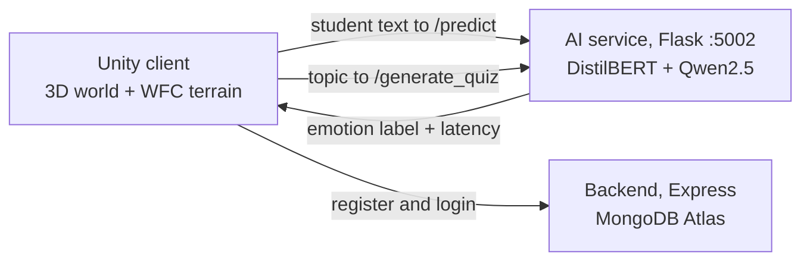

# MAGSEL

A Unity metaverse for social-emotional learning that reads a student's text, classifies the emotion, and adapts to it.

There is no demo GIF yet: the Unity client needs a local AI service and model weights that are not in the repo, so I have not recorded one rather than fake it.

**Proof:** DistilBERT emotion classifier at roughly 92% accuracy and 0.93 weighted F1 on the held-out split of the Hugging Face `emotion` dataset (my fine-tune run; the number is not re-run in CI).

Solo research project, presented at the WILLS 2025 Conference, Kyoto University of Foreign Studies, Japan.

## What it is and why

A learning environment normally reacts to what a student clicks. MAGSEL reacts to how the student says they feel. A Unity client sends free text to a local Flask service, gets back one of six emotion labels, and adapts. The same service generates quiz questions from a topic with a local Qwen2.5-0.5B model, so nothing leaves the machine.

## What was hard

- **Terrain that stays the same on every client.** The world is built with a Wave Function Collapse solver I wrote from scratch in C# (`Frontend/Metaverse/Assets/Scripts/Terrain/WaveFunctionCollapse.cs`). A networked manager keeps the generated terrain consistent across clients, and `TerrainBenchmark.cs` measures generation time.
- **Strict JSON from a 0.5B model.** `/generate_quiz` and `/generate_topic_chunk` have to return parseable JSON for the Unity side, which a small model does not do on its own.
- **Honest evaluation.** `accuracy_test.py` checks the live API, not only the training split: per-class precision and recall, a confusion matrix and latency.

## Architecture



## Run it

```bash
cd "Metaverse Files" && pip install -r requirements.txt
python fine_tune_emotion.py        # writes distilbert-finetuned-emotion/
# download Qwen/Qwen2.5-0.5B-Instruct into "Metaverse Files/Qwen2.5-0.5B-Instruct/"
python appp.py                     # http://localhost:5002
```

Then open `Frontend/Metaverse/` in Unity. The accounts backend and the endpoint list are in [docs/api.md](docs/api.md).

## Tests

`python accuracy_test.py` (in `Metaverse Files/`, with the service running) scores the live API; `python benchmark.py` times it. There is no automated test suite or CI workflow for the Unity or Node parts.

## Limits and not done

- Model weights are not committed. The emotion model must be fine-tuned locally and Qwen downloaded from Hugging Face.
- `additional_data.xlsx` (the custom augmentation set) is not in the repo, so a re-run trains on the Hugging Face dataset alone and may not match the 92% figure.
- No hosted demo. It is a research prototype, not a deployed product.
- Account routes exist (`POST /user/register`, `POST /user/login`); I have not security-reviewed them for real student data.

## Stack

Unity, C#, Python, PyTorch, Hugging Face Transformers, DistilBERT, Qwen2.5-0.5B-Instruct, Flask, Node.js, Express, MongoDB.

## License

MIT, see [LICENSE](LICENSE). Bundled third-party Unity assets (FishNet, Kenney kits, TextMesh Pro, VRM/UniGLTF, StarterAssets) keep their own licenses under `Frontend/Metaverse/Assets/`.

By Daniel Alexis Cruz, [dacruz.vercel.app](https://dacruz.vercel.app).
