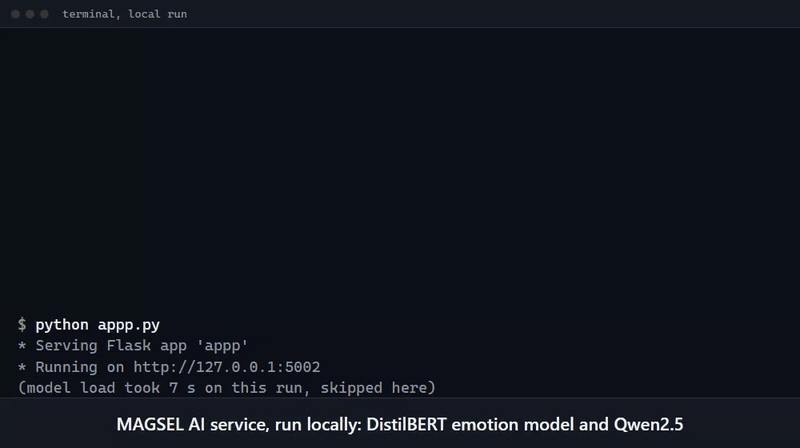
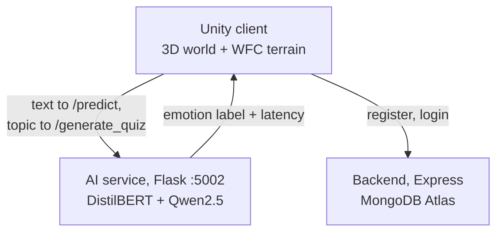

# MAGSEL

A Unity metaverse for social-emotional learning that reads a student's text, classifies the emotion, and adapts to it.



*The AI service the Unity client calls, running locally on CPU: four sentences I wrote, each answered with an emotion label and the service's own latency. Replayed in a terminal from a recorded session of the real service on 2026-10-17, using a re-run of this repo's fine-tune recipe.*

**Proof:** 93.5% accuracy and 0.934 weighted F1 on the validation split, 91.9% and 0.918 on the test split, for a DistilBERT emotion classifier fine-tuned on the Hugging Face `dair-ai/emotion` dataset (2 epochs, 19 minutes on CPU).

*Source: `Metaverse Files/fine_tune_emotion.py`, measured 2026-10-17. Caveat: the figures come from an edited copy of that script, the committed file has only run as a 2,000-row, 1-epoch smoke test (52% test accuracy), and CI does not re-run it.*

Solo research project, presented at the WILLS 2025 Conference, Kyoto University of Foreign Studies, Japan.

## What it is and why

A learning environment normally reacts to what a student clicks. MAGSEL reacts to how the student says they feel. A Unity client sends free text to a local Flask service, gets back one of six emotion labels, and adapts. The same service generates quiz questions from a topic with a local Qwen2.5-0.5B model, so the student's text and the quiz generation stay on the AI service you run yourself. Accounts are separate: the Express backend stores them in MongoDB Atlas.

## What was hard

- **Terrain that stays the same on every client.** The world is built with a Wave Function Collapse solver I wrote from scratch in C# (`Frontend/Metaverse/Assets/Scripts/Terrain/WaveFunctionCollapse.cs`). A networked manager keeps the generated terrain consistent across clients, and `TerrainBenchmark.cs` measures generation time.
- **JSON from a 0.5B model.** `/generate_quiz` and `/generate_topic_chunk` need parseable JSON for the Unity side, which a small model does not reliably produce. The service strips markdown code fences (`remove_markdown_fences` in `appp.py`), tries `json.loads`, and on a parse failure returns the raw generated text under `generated_quiz` or `generated_topic_chunk` instead. It does not guarantee strict JSON.
- **Surprise is mapped to joy.** `EmotionAnalyzer.cs` rewrites a `surprise` prediction to `joy` before it drives the terrain, so the client effectively uses five emotions.

## Architecture



## Run it

You need Python (tested on 3.13) and a connection to Hugging Face for the dataset and the two base models. No GPU is needed: the fine-tune uses CUDA when it finds it and falls back to CPU otherwise.

```bash
cd "Metaverse Files"
python -m venv venv && source venv/bin/activate     # Windows: venv\Scripts\activate
pip install -r requirements.txt
python fine_tune_emotion.py       # about 19 minutes on CPU; writes distilbert-finetuned-emotion/
```

It prints the validation and test metrics and a per-class report. To check that the pipeline runs end to end, add `--max-train-samples 2000 --epochs 1` (3.8 minutes on CPU here, including the downloads); that trains too little to reach the figures above. Then download `Qwen/Qwen2.5-0.5B-Instruct` into `Metaverse Files/Qwen2.5-0.5B-Instruct/` and start the service:

```bash
python appp.py                    # http://localhost:5002
```

Then open `Frontend/Metaverse/` in Unity. Every server address the client uses is in one file, `Frontend/Metaverse/Assets/Scripts/ApiConfig.cs`: `AiServiceBaseUrl` defaults to `http://localhost:5002` and `AccountsBaseUrl` to `http://localhost:3000`, where `Backend/` listens once you have created its `.env`. I did not open the Unity project after moving the addresses into that file, so it has not been compiled since. The endpoint list is in [docs/api.md](docs/api.md).

## Tests

`python accuracy_test.py` (in `Metaverse Files/`, with the service running) scores the live API on 48 hand-written sentences, eight per emotion, and prints per-class precision and recall, a confusion matrix and latency. It is a smoke check of the running service, not the held-out evaluation behind the figures above. `python benchmark.py` times the endpoints. There is no automated test suite or CI workflow for the Unity or Node parts.

## Limits and not done

- Model weights are not committed. The emotion model must be fine-tuned locally and Qwen downloaded from Hugging Face.
- An earlier version of the fine-tune also trained on a custom spreadsheet of extra sentences (`additional_data.xlsx`), which is not in the repo. The committed recipe and the figures above use the Hugging Face data only.
- No hosted demo. It is a research prototype, not a deployed product.
- Account routes exist (`POST /user/register`, `POST /user/login`); I have not security-reviewed them for real student data.

## Stack

Unity, C#, Python, PyTorch, Hugging Face Transformers, DistilBERT, Qwen2.5-0.5B-Instruct, Flask, Node.js, Express, MongoDB.

## License

MIT, see [LICENSE](LICENSE). Bundled third-party Unity assets (FishNet, Kenney kits, TextMesh Pro, VRM/UniGLTF, StarterAssets) keep their own licenses under `Frontend/Metaverse/Assets/`.

By Daniel Alexis Cruz, [dacruz.vercel.app](https://dacruz.vercel.app).
